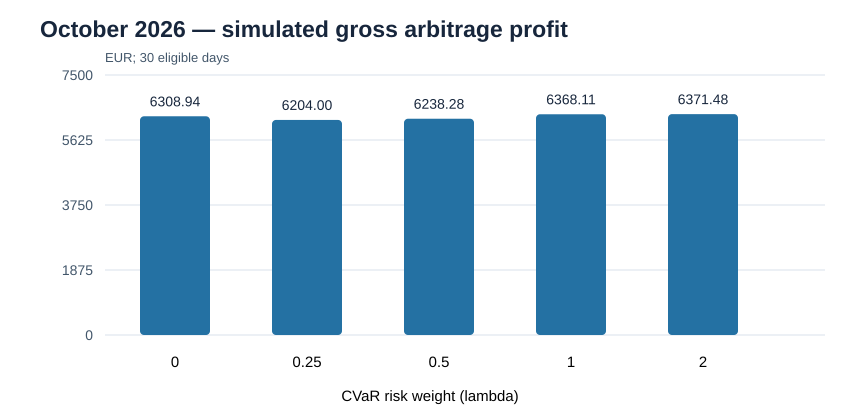
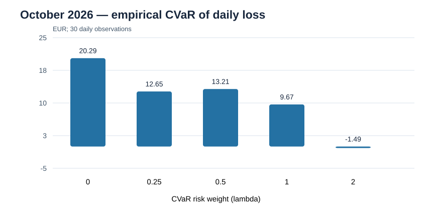

# BESS — Risk-Aware Battery Dispatch Optimization

A reproducible Python research and portfolio project for **day-ahead battery energy storage system (BESS) arbitrage**, combining electricity-price scenario generation, mixed-integer linear programming (MILP), and Conditional Value at Risk (CVaR).

> **Status:** Research demonstration with automated tests and a completed October 2026 historical simulation. This is **not** a verified live trading system or a claim of commercial profitability. October 2026 was used during development and is **not** an untouched out-of-sample holdout.

## Project at a glance

| Component | Implementation |
| --- | --- |
| Market data | Historical 15-minute DE-LU day-ahead electricity prices |
| Scenario generation | Quantile gradient-boosting models and historical daily residual bootstrap |
| Optimization | Battery charge/discharge MILP formulated in Pyomo and solved with HiGHS |
| Risk | CVaR-based downside-risk objective with configurable risk weight |
| Evaluation | Historical realized-profit simulation, risk-neutral baseline, and perfect-foresight oracle |
| Engineering | Python unit tests, GitHub Actions, validated data pipeline, reproducible JSON reports |

## Why this project?

Day-ahead electricity prices are uncertain when battery schedules must be selected. A deterministic dispatch policy can appear profitable under perfect price foresight but be unrealistic in practice. This project generates multiple plausible price paths, optimizes a feasible battery schedule under those scenarios, and examines how the CVaR risk weight affects simulated realized profit and downside exposure.

The objective is to demonstrate a **complete quantitative workflow**—from market data through forecasting, constrained optimization, evaluation, and automated testing—rather than to claim deployment readiness.

## Methodology

1. **Historical data:** Validate a continuous, timestamped 15-minute DE-LU price history. Reject missing values, duplicate timestamps, and irregular intervals.
2. **Price scenarios:** Train quantile gradient-boosting models on historical dates and combine their estimates with bootstrapped full-day residual profiles to produce 50 price scenarios per eligible delivery day.
3. **Battery optimization:** Use a Pyomo MILP with charge/discharge power limits, energy balance, charging and discharging efficiencies, state-of-charge limits, and daily terminal-energy constraints.
4. **Risk-aware dispatch:** Compare risk weights `lambda = 0, 0.25, 0.5, 1, 2` using a CVaR formulation. The risk-neutral configuration (`lambda = 0`) is a baseline.
5. **Historical evaluation:** Evaluate fixed schedules against observed prices after optimization. Compare with a perfect-foresight **oracle**, which is an unattainable upper-bound reference, not a tradable strategy.
6. **Walk-forward protocol:** Train and calibrate each target month's scenario model using strictly earlier dates. Select the next month's risk weight using only earlier evaluated months. The multi-month workflow is implemented but has **not yet produced a verified multi-month empirical result**.

The scenario and dispatch workflows currently exclude days with other than 96 quarter-hour delivery intervals, including daylight-saving transition days. These exclusions are reported.

## Battery assumptions

The example system is **illustrative**, not a verified physical asset:

| Parameter | Value |
| --- | ---: |
| Energy capacity | 2 MWh |
| Charge/discharge power | 1 MW |
| Charging efficiency | 95% |
| Discharging efficiency | 95% |
| Initial and terminal state of charge | 1 MWh |
| Variable operating cost | 0 EUR/MWh (simplification) |

The optimization enforces a cyclic daily state of charge rather than interday carryover. Degradation, market fees, imbalance costs, asset availability, and network constraints are not fully represented.

## Historical results — October 2026

The end-to-end monthly scenario and optimization pipeline was executed on **30 eligible delivery days**. October 25 (daylight-saving transition, 100 intervals) was excluded. September 2026 was used for scenario calibration.

| CVaR risk weight (lambda) | Simulated total profit (EUR) | Empirical CVaR of daily loss (EUR) |
| ---: | ---: | ---: |
| 0 | 6,308.94 | 20.29 |
| 0.25 | 6,204.00 | 12.65 |
| 0.5 | 6,238.28 | 13.21 |
| 1 | 6,368.11 | 9.67 |
| 2 | 6,371.48 | -1.49 |
| Perfect-foresight oracle | 10,409.79 | -129.37 |

**Interpretation:** These are *simulated gross arbitrage results* for the illustrative battery, not realized revenues. Choosing the best risk weight after inspecting October outcomes would bias any claim of independent October performance. CVaR estimated from only 30 daily observations is particularly unstable. The oracle is not operationally achievable.

See [the documented October experiment](docs/ROLLING_OCTOBER_RESULTS.md) and [the successful end-to-end GitHub Actions run](https://github.com/SaeedAkbare/BESS/actions/runs/42409185906).

## October 2026 evaluation charts

The following charts visualize the documented October experiment for an illustrative 2 MWh / 1 MW battery. They use the aggregate figures in [ROLLING_OCTOBER_RESULTS.md](docs/ROLLING_OCTOBER_RESULTS.md), not newly generated dispatch or price time series.





**Reading the charts:** Results cover 30 eligible October 2026 days. They are exploratory simulated gross profits and empirical downside-risk estimates, not verified trading revenues. The 30-day CVaR estimates are unstable; selecting the best lambda from October outcomes would introduce hindsight bias. The perfect-foresight oracle is excluded from these policy-comparison charts because it is not a feasible trading strategy.

## Reproduce the project

Requires Python and the dependencies in `requirements.txt`, including Pyomo and the HiGHS solver.

```bash
python -m pip install -r requirements.txt
```

Provide a **complete, validated** historical 15-minute DE-LU price CSV, then run the single-month demonstration:

```bash
python battery_monthly_scenarios.py \
  --history output/extended_prices.csv \
  --month 2026-10 \
  --output output/october_demo.json \
  --seed 42
```

Replace `output/extended_prices.csv` with the actual path to the validated dataset. The command generates scenario diagnostics, dispatch schedules, per-day outcomes, and aggregate risk/profit results in JSON.

For a detailed execution guide, see [SINGLE_MONTH_DEMO.md](docs/SINGLE_MONTH_DEMO.md).

### Run automated tests

```bash
python -m unittest discover -s tests -t . -p "test_battery*.py"
python -m unittest tests.test_extend_price_history tests.test_run_battery_walk_forward
```

The battery optimization workflow was also [successfully run on the `main` branch](https://github.com/SaeedAkbare/BESS/actions/runs/42421196816). Automated test success does not establish predictive accuracy or commercial feasibility.

### Future multi-month evaluation

The [walk-forward protocol](docs/WALK_FORWARD_PROTOCOL.md) specifies monthly model cutoffs, prior-month risk-weight selection, data checks, and uncertainty reporting. Run it only when **at least two complete, validated evaluation months** are available. The November 2026 month must be complete before it can be included. No multi-month out-of-sample result is claimed at present.

## Key files

| File | Purpose |
| --- | --- |
| `scenarios.py` | Electricity-price scenario modeling |
| `battery_optimization.py` | Battery MILP and CVaR formulation |
| `battery_monthly_scenarios.py` | End-to-end monthly scenario generation and dispatch evaluation |
| `battery_walk_forward.py` | Prior-month risk-weight selection and walk-forward metrics |
| `run_battery_walk_forward.py` | Multi-month evaluation orchestration |
| `extend_price_history.py` | Historical data extension and validation |
| `docs/ROLLING_OCTOBER_RESULTS.md` | Documented October 2026 numerical results |
| `docs/WALK_FORWARD_PROTOCOL.md` | Prospective evaluation protocol |
| `.github/workflows/` | Continuous integration and evaluation workflows |

## Portfolio skills demonstrated

**Energy market analytics · Stochastic optimization · MILP · Pyomo · HiGHS · CVaR · Time-series modeling · Battery energy management · Python · Automated testing · Reproducible backtesting**

## Limitations and next steps

- Validate the workflow prospectively on additional complete months not used during development or tuning.
- Quantify forecasting calibration, profit uncertainty, and robustness across changing market conditions.
- Add site-specific battery constraints, degradation, trading fees, and operational costs before considering real-world deployment.
- Expand visual reporting with price scenarios, dispatch profiles, state of charge, and risk-return comparisons.

**Scope:** This repository demonstrates research and engineering methods. It does not provide investment advice, guaranteed returns, or a production trading system.
